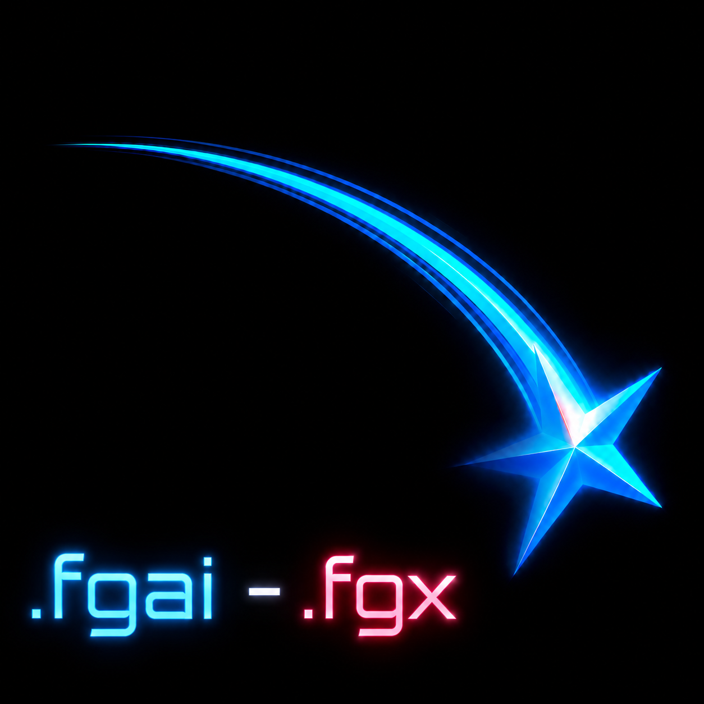

<p align="center">
  
</p>

<h1 align="center">Forgentex</h1>

<p align="center">
  <b>The systems language designed for AI coding agents — and the humans who review them.</b>
</p>

<p align="center">
  
  
  
  
  
</p>

```text
Humans design and audit.
Agents build and optimize.
Compiler enforces truth.
```

---

## What is this?

Most programming languages are designed for human fingers. Forgentex is
designed for a world where **AI agents write most of the code** and humans
act as architects, reviewers, and safety auditors.

The same program always exists in two forms — two lossless views of one AST:

<table>
<tr>
<th><code>.fgx</code> — what humans review</th>
<th><code>.fgai</code> — what agents read &amp; write</th>
</tr>
<tr>
<td>

```python
struct Point:
    x: i32
    y: i32

fn area(width: i32, height: i32) -> i32:
    return width * height
```

</td>
<td>

```text
S Point { x i32; y i32 }

F area(width i32, height i32) -> i32 {
  R width * height
}
```

</td>
</tr>
</table>

And agents don't rewrite files — they send **semantic patches** that the
compiler validates before anything touches disk:

```text
PATCH @function.mix_samples
INSERT_FAST_PATH target=x86_64,avx2 call=mix_samples_avx2
ADD_UNSAFE_ASM_STUB name=mix_samples_avx2 target=x86_64 effect=cpu.avx2
```

The compiler answers with a review report a human can act on in seconds:
*what changed, which unsafe/assembly/ABI/effect surfaces it touched, and
which tests prove it*.

## Why would I want this?

When an LLM edits a normal codebase it burns tokens on formatting, reads
whole files to change one function, breaks things with fragile text diffs,
and gets compiler errors written for humans. Forgentex treats the program
as a **typed semantic database** instead:

- 🗺️ **Project maps** (`.fgmap`) let an agent navigate a codebase by symbol
  and load only the nodes it needs — with token-cost estimates.
- 🩹 **Semantic patches** (`.fgp`) are small, validated, signable, and
  conflict-checked by node hash — no more "the diff didn't apply".
- 🤖 **Machine-readable diagnostics**: every error has a stable code, a node
  ID, expected/found types, and *suggested repair patches* an agent can
  apply directly (`fgx fix --plan`).
- 🛡️ **Safety you can audit**: ownership and borrow checking, an effect
  system (`io.read`, `network.write`, `crypto.sign`, `cpu.avx2`, …),
  explicit `unsafe`, and structured assembly with validated registers and
  clobbers — all surfaced in review reports.
- ⚡ **A systems core**: Rust-inspired ownership, Zig-inspired explicitness,
  slices, SIMD vector types, ABI/layout reports, C11 and Zig backends.

## Try it in two minutes

All you need is [Rust](https://rustup.rs). The toolchain has **zero
dependencies** — `cargo build` and you have the whole thing.

```bash
git clone <this-repo> && cd Forgentex
cargo build --release

# parse the same program in both syntaxes
cargo run --bin fgx -- fmt examples/hello.fgx --to fgai

# type-check with agent-readable diagnostics
cargo run --bin fgx -- check examples/media/audio_mix.fgx --json

# run a real program through the interpreter
cargo run --bin fgx -- run examples/media/audio_mix.fgx

# apply a semantic patch and get the human review report
cargo run --bin fgx -- patch examples/media/audio_mix.fgx patches/add_fast_path.fgp --review

# see the borrow checker's dataflow evidence
cargo run --bin fgx -- borrow-report examples/media/audio_mix.fgx --json

# ask the toolchain to grade itself
cargo run --bin fgx -- release-check --target v1.0 --strict
```

That last command exits zero: **all fifteen v1.0 maturity gates pass.**

## The project in numbers

| | |
| --- | --- |
| 🧰 CLI commands (`fgx`) | **41** — parse, check, patch, run, build, bench, audit, map, graph, lsp… |
| 📚 Standard library modules | **14** (`core.mem`, `core.slice`, `core.math`, `core.simd`, `core.crypto`, …) |
| 🏗️ Compiler modules | **40** files, **~34,800 lines** of dependency-free Rust |
| ✅ Tests | **218** (unit + integration) plus a **30-case** borrow conformance suite |
| 🧪 Diagnostic catalog | **47** stable error codes, each with explanation and repair plan |
| 🖥️ CPU architectures | **5** (x86_64, ARMv7, AArch64, RISC-V 32, RISC-V 64), 8 target triples |
| ⚙️ Backends | AST interpreter + **C11** and **Zig** source backends |
| 📦 Examples | **52** — media/DSP kernels, assembly, networking, signed patches, packages |
| 📖 Design docs | **51** in [`docs/`](docs/), one per subsystem with acceptance gates |
| 🏁 Milestones shipped | **27**, from v0.1 first demo to the v1.0 release |
| 🔌 Editor support | Dependency-free **LSP server** + **VS Code extension** package |

## The road to v1.0

The hardest gate was the last one: ownership and borrow checking. It was
built in 13 staged increments (field-sensitive moves, non-lexical borrow
endings, loop-carried liveness, conditional borrow-state joins, reborrow
chains, projection alias analysis, interprocedural lifetime contracts…)
and then unified in v1.0 by a **CFG dataflow borrow checker**: moved paths,
alias places, and liveness computed as fixpoint analyses over the
control-flow graph, so every control-flow shape — nested loops, branch
reassignments, re-moves across loop back edges — is checked by one
algorithm instead of special cases. A built-in conformance suite
(`fgx borrow-conformance`) pins all of it.

Every other gate shipped along the way: stable dual grammar and AST schema,
the semantic patch protocol, project-wide checking with manifests and
public-API reports, the effect system, structured assembly validation for
five architectures, portable SIMD with enforced scalar fallbacks, ABI and
layout reports, a package manager with lockfiles and audits, fuzzing and
interpreter-vs-backend differential tests, and the agent workbench protocol
(compact context packets with token budgets).

## What's next (v2)

- 🧬 **Foreign code capsules** — typed, sandboxed, version-pinned blocks of
  Python, JavaScript, TypeScript, C, CUDA, Solidity and more, inside
  Forgentex projects ([roadmap](docs/v2_roadmap.md))
- 🔗 **Shared typed namespace** — declare a variable once in Forgentex, use
  it by the same name natively in Python *and* JavaScript, with the
  backend and frontend of one app under one roof
  ([design](docs/v2_shared_namespace.md))
- 🪙 **Token optimization** — compressed capsule views, the compact
  documentation register, and a 20-technique catalog for cutting agent
  token costs ([design](docs/token_optimization_v2.md))

## Dig deeper

- [docs/mature_language_development_plan.md](docs/mature_language_development_plan.md) — the complete development plan
- [docs/grammar_human_fgx.md](docs/grammar_human_fgx.md) / [docs/grammar_agent_fgai.md](docs/grammar_agent_fgai.md) — the two grammars
- [docs/semantic_patch_protocol_v1.md](docs/semantic_patch_protocol_v1.md) — how agents edit code
- [docs/borrow_checker_v1.md](docs/borrow_checker_v1.md) — the safety model
- [docs/agent_workbench_protocol.md](docs/agent_workbench_protocol.md) — how agents talk to the compiler

## Status & contributing

Forgentex is a research-grade v1.0: the language surface is intentionally
small, the workflow is real. Everything is verified by
`cargo test`, `cargo clippy -- -D warnings`, fuzzing, differential tests,
and the toolchain's own `fgx release-check`. If the idea of an
agent-native, human-auditable systems language excites you — issues, ideas,
and experiments are very welcome.

**License:** MIT OR Apache-2.0
**Viktors Roze**
