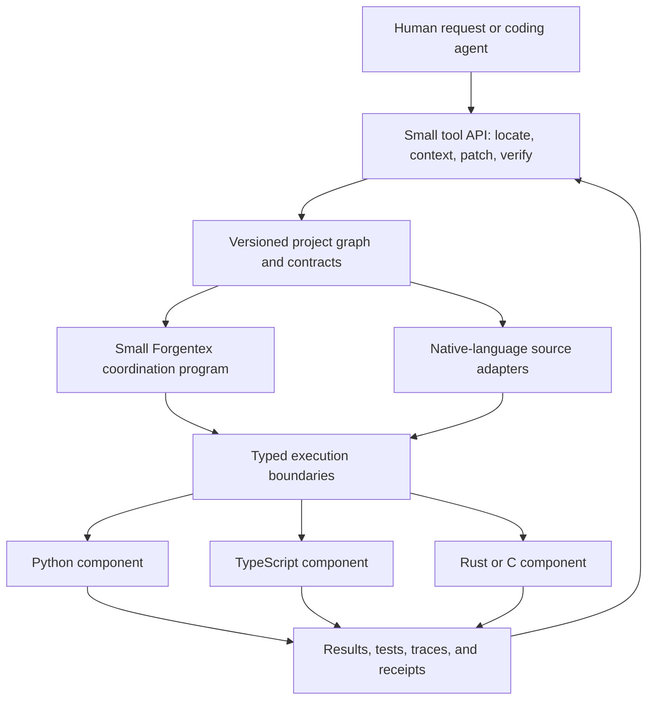

# Forgentex: technical evaluation and path to practical AI-assisted development

Date: 2026-09-05. Repository base commit: `23beff5542d801bcdd8a29c1d4d3f008acb696b3`.

This assessment examines the current working tree, including the pre-existing uncommitted compiler, debugger, environment-resolution, and editor changes. It combines source inspection, local execution, token measurements, and current official documentation. It is an engineering assessment, not a formal proof of language soundness or a completed benchmark of AI coding performance. No paid model inference was performed.

## 1. Assessment

**Forgentex has a useful architectural direction and substantial working implementation. Its strongest opportunity is a typed coordination and editing layer for AI-assisted polyglot projects. Its compact syntax alone does not yet provide a reliable token advantage, and several current guarantees need tightening before developers can depend on them.**

The most valuable combination is:

1. One checked program model, with readable human presentation and machine-oriented access.
2. Small, typed context packets that let an agent inspect only the relevant part of a project.
3. Versioned, validated edits with machine-readable feedback.
4. Explicit contracts around code written in other languages.
5. Runtime evidence that connects a failure to the symbol and contract that need repair.

These capabilities can reduce repeated investigation, integration mistakes, and review effort even when source token counts barely improve. That is a stronger product proposition than making every language look shorter.

| Question | Assessment | Confidence and limitation |
| --- | --- | --- |
| Is this more than a language sketch? | Yes. There are implemented parsers, checking, interpretation, source backends, foreign bridges, agent tools, and extensive tests. | High: implementation and local execution. |
| Is the architecture coherent? | Largely. Shared semantics, explicit effects, and contract boundaries fit together. | Medium-high: some contracts are stronger than their current enforcement. |
| Does `.fgai` reliably save tokens? | No. The measured result depends on the source and tokenizer; several samples get larger. | High for the measured samples; no claim about every tokenizer or program. |
| Can focused context reduce transmitted content? | Yes. The unchanged waveform context packet became 42.1% smaller under one BPE encoding. | High for that packet; this is not an end-to-end API cost result. |
| Can it combine languages? | Yes, within specific bridge and runtime subsets. | High that bridges exist; lower for complete ecosystem compatibility and portable isolation. |
| Is it ready as the foundation of an arbitrary production application? | No. Prefer bounded pilots and retain mature host-language infrastructure. | High: public release remains unready, and this review found concrete correctness/tooling gaps. |
| Is continued development worthwhile? | Yes, if it concentrates on measurable workflow improvements and dependable boundaries. | Strategic judgment, to be tested with external users. |

**Recommended positioning:** “Build and safely change projects across languages using explicit contracts and focused AI context.” Keep the language as a small executable coordination layer, and make its tooling usable around existing projects without requiring a rewrite.

## 2. What is technically strong

### Shared semantics across two presentations

The dual-view design is sensible: both syntaxes feed the same AST and checker rather than defining separate semantics. Canonical-equivalence and round-trip tests exist in [canonical_ast.rs](../src/tests/canonical_ast.rs); formatting is implemented in [format.rs](../src/format.rs). This avoids maintaining two independent implementations of the user's program.

Keep readable `.fgx` as the normal review surface. Generate `.fgai` when it actually helps an agent. Canonical AST equivalence is a semantic preservation property; it does not imply byte-for-byte preservation of comments, formatting, or other source trivia. A production editing workflow should preserve those separately.

### Compiler-aware context and edits

The [agent workbench](agent_workbench_protocol.md), [patch implementation](../src/patch.rs), and [node policy](node_id_policy.md) already address real problems: irrelevant context, stale edits, and ambiguous diagnostics. Node-hash preconditions are implemented, so the improvement needed is to make them dependable defaults in an agent adapter, rather than invent a second patch mechanism.

Structured debugging also belongs here. The current tree contains [DAP support](../src/dap.rs), [foreign debugging](../src/foreign_debug.rs), and an extensive [debugger design record](debugger_plan.md). Failures tied to node IDs can shorten an agent's repair loop. This is a useful differentiator beyond token compression.

### Explicit effects, ownership, and bounded execution

The repository contains substantial ownership and borrow-checking machinery, including CFG-based analysis and reference/conformance cases. The local borrow-conformance run passed **1,962 of 1,962 cases**. This is meaningful evidence for the tested rules, though it is not a proof that every accepted program is memory-safe.

Explicit effects and capabilities are especially useful for automated edits: the tool can identify a newly introduced filesystem, network, or foreign-runtime requirement without asking the model to discover it from arbitrary source text.

The [pipeline runtime](pipeline_runtime.md) also has valuable transactional behavior around ownership transfer, staged outputs, budgets, and failure. Its existing versioned values and receipts are worth strengthening. Their value is dependable composition and diagnosability, not merely shorter prompts.

### Explicit backend limits

The interpreter-first [public profile](public_0_1_profile.md) and [execution matrix](public_0_1_execution_matrix.md) are good decisions. The C/Zig backends reject unsupported constructs through backend contracts instead of claiming universal support. Preserve that discipline.

C source generation is a practical initial implementation strategy. A new language does not need LLVM, a JIT, and several optimized backends to prove that its coordination model is useful.

## 3. Findings that should change the priorities

### F1. Compact syntax sometimes uses more BPE tokens

I measured the output of `fgx fmt <file> --to fgx|fgai`, normalized to LF and including its trailing newline. The tokenizer was `js-tiktoken` **1.0.21**, using `cl100k_base` and `o200k_base`. These are actual BPE encoding counts for these strings, not the repository's heuristic. They are **not asserted to be the tokenizer of every latest model**, and exclude API framing, prompts, tool schemas, reasoning, and retries. See the [tokenizer implementation](https://github.com/dqbd/tiktoken/tree/main/js) and [OpenAI's tiktoken explanation](https://github.com/openai/tiktoken).

| File under `examples/` | Heuristic agent/human | `cl100k_base` human → agent | `o200k_base` human → agent | BPE interpretation |
| --- | ---: | ---: | ---: | --- |
| `hello.fgx` | 0.8600 | 37 → 32 | 37 → 32 | 13.5% smaller |
| `media/audio_mix.fgx` | 0.8186 | 151 → 128 | 151 → 128 | 15.2% smaller |
| `audio/src/dsp.fgx` | 0.9670 | 869 → 877 | 870 → 878 | About 0.9% larger |
| `capsule/normalize_python.fgx` | 0.8860 | 148 → 150 | 149 → 150 | About 0.7–1.4% larger |
| `capsule/web_session.fgx` | 0.8897 | 314 → 313 | 315 → 315 | Essentially unchanged |
| `smoke/inline_tests.fgx` | 0.9688 | 121 → 130 | 123 → 132 | About 7.3–7.4% larger |
| `apps/wav_waveform/src/main.fgx` | 0.9494 | 1,093 → 1,144 | 1,102 → 1,153 | About 4.6–4.7% larger |
| `apps/media_visualizer/src/main.fgx` | 0.8852 | 1,457 → 1,459 | 1,459 → 1,471 | About 0.1–0.8% larger |
| **Combined sample** | — | **4,190 → 4,233** | **4,206 → 4,259** | **About 1.0–1.3% larger** |

This is a small convenience sample, not a representative language benchmark. It is nevertheless sufficient to disprove the assumption that the current compact surface always reduces tokens. The heuristic can predict the wrong direction, not just the wrong absolute count. In particular, the “fair and monotonic” interpretation in [tokens.rs](../src/tokens.rs) does not establish reliable BPE ratios.

**Suggestion:** retain the fast heuristic for approximate local estimates, but label it clearly. Add provider/tokenizer-aware whole-payload measurements. Select between readable source, compact source, and encoded transport using both measured token cost and model task success. These measurements do not evaluate every minified or codebook representation; those require their own comparisons.

Do not optimize primarily for characters or single-letter names. Familiar names can cost less in reasoning and repair even when they occupy more input tokens. Treat that as a hypothesis to measure, not an assumed property of any model.

### F2. The edit benchmark is a cost model, not a measured coding task

[edit_bench.rs](../src/edit_bench.rs) computes:

```text
whole_file_total = file_tokens * (1 + edits)
patch_total      = map_tokens + edits * (average_function_tokens + sample_patch_tokens)
```

The benchmark does not ask an AI to perform the edits, apply the representative patch, or verify that both strategies complete the same task. The representative patch is a fixed statement involving `width * gain`; it is not generally a valid edit for the input program.

There is also a concrete edge case: `average_symbol_tokens` returns zero for a file without functions. Running the benchmark on `examples/capsule/web_session.fgx` with eight edits produced:

```text
functions=0; symbol_tokens=0
whole_file_total=3915; patch_total=221; patch_over_whole=0.0564
```

That does not establish a 94.4% saving on actual capsule maintenance. It charges no target-body reading and still invents a function patch. Existing figures should be presented as illustrative estimates under their assumptions.

**Suggestion:** reject unsupported edit-task shapes or model actual capsule edits. More importantly, compare against conventional agents using symbol retrieval, cached context, and small text patches. Repeated whole-file generation is a useful weak baseline, but it cannot establish the advantage over a well-configured existing workflow.

### F3. Stateful context has a measured benefit, with an important condition

For `@function.render_waveform` in `examples/apps/wav_waveform`, requesting `types,effects,tests` produced these **complete serialized JSON** counts under `o200k_base`:

| Packet | Tokens |
| --- | ---: |
| Full packet | 1,453 |
| Unchanged packet using `--since` | 841 |
| Reduction on that subsequent packet | 612, or 42.1% |

This is stronger evidence for the context architecture than the surface-syntax figures. It still requires the receiver to possess the omitted content. A hash is an identity, not a compressed explanation that an unfamiliar model can reconstruct.

After model switching, conversation compaction, eviction, or a new session, rehydrate any needed sections. A host-side cache hit does not imply those contents are available inside the model's effective context. Also distinguish bytes transmitted to the API, tokens in the model's context, cached input billing, and newly processed input. Saving one does not automatically save the others.

### F4. `@exact` is not currently a transitive guarantee

This program passed `fgx check --json` with an empty diagnostic list:

```fgx
fn approximate(x: i32) -> i32:
    return i32(f64(x) * 0.1)

@exact
fn allegedly_exact(x: i32) -> i32:
    return approximate(x)
```

The reason is visible in [numeric.rs](../src/numeric.rs): call expressions check their arguments for floating-point syntax, but do not establish that the callee itself is float-free. Named type definitions are also not recursively resolved by this check.

**Suggestion:** define the exact contract narrowly and implement it on resolved types and the call graph, including recursive call groups and trusted foreign/intrinsic contracts. Until then, describe the existing check as a local restriction, not a proof of exact or backend-independent arithmetic. Integer-only computation also needs defined overflow, division, shift, and conversion rules; fixed-point computation can still round or truncate relative to real-number mathematics.

### F5. CLI checking can report errors and still exit successfully

This command emitted `mutable_borrow_alias` and returned exit code **0**:

```powershell
.\target\debug\fgx.exe check examples/smoke/borrow_alias_bad.fgx --json
$LASTEXITCODE
```

[cmd_check in cli.rs](../src/cli.rs) returns success after printing diagnostics. The project-check branch has the same pattern. A build script or AI tool wrapper that trusts process success can therefore misclassify a rejected program.

**Suggestion:** make semantic errors produce a nonzero exit status, or introduce and require an explicit strict validation mode if compatibility prevents changing the default immediately. Preserve the JSON response on failure. Document distinct outcomes for invalid programs, parse errors, unavailable dependencies, and internal failures. Until fixed, adapters must inspect diagnostics rather than trust exit status alone.

### F6. `diff-test` does not compare native execution with interpretation

The local command returned `result: pass`. However, [run_backend_differential in fuzzing.rs](../src/fuzzing.rs) executes the interpreter, generates C, and checks that the entry name appears in generated source/header and IR. It does **not** compile and execute that C and compare the result.

This is useful structural coverage, but the command name implies stronger evidence. Other tests, including [public_profile.rs](../src/tests/public_profile.rs), do compile and run C when a compiler exists; this finding does not mean the repository has no native execution tests.

**Suggestion:** rename the current check or extend it to compare outputs, mutations, traps, and evaluation order from actual interpreter/C/Zig runs. Cover boundary values and multiple optimization levels. Mark absent toolchains as explicit skips, and require actual execution in release jobs for every advertised backend.

### F7. Foreign-runtime policy and isolation are different things

The native path has substantial containment work. On Windows the implementation and tests cover restricted tokens, AppContainers, Job Objects, controlled scratch access, and resource evidence. The [platform verification document](native_containment_platform_verification.md) also explicitly records remaining Linux/macOS isolation gaps. This is better than merely attaching a sandbox label.

In contrast, [Python invoke_live](../src/python_run.rs) checks declared sandbox/effect compatibility and then uses ordinary `Command::output()`. The inspected [warm-worker launch and call paths](../src/capsule_worker.rs) use ordinary processes and a blocking line read. Those paths do not establish equivalent OS-enforced filesystem/network denial or bounded response time and size.

Foreign code can behave differently from its declaration. A Python or C body declaring no filesystem effect is not thereby proven unable to read files.

**Suggestion:** publish a per-runtime, per-platform enforcement matrix. Distinguish declared effects, checker approval, enforced capabilities, and observed actions. Give managed workers a common supervised runner with bounded frames, deadlines, cancellation, process-tree cleanup, and explicit environment/secret handling. Put debug output on a separate channel from the response protocol. Support trusted execution as an explicit profile; do not silently substitute it when requested isolation is unavailable.

This matters directly to the product: an agent should know which assurances it can rely on when it requests only a boundary card.

### F8. Other contracts need more precise wording and evidence

| Area | Evidence and concern | Suggested change |
| --- | --- | --- |
| Native numeric behavior | [c_backend.rs](../src/c_backend.rs) emits ordinary C binary operators; [native_build.rs](../src/native_build.rs) does not establish a general wrapping policy. The memory-safety document's claim that ordinary emitted C overflow wraps is too broad. | Specify numeric semantics per width and operation, then lower explicitly and test them. GCC documents wrapping as a specific compiler option; portable C emission should not assume it. [GCC documentation](https://gcc.gnu.org/onlinedocs/gcc/Code-Gen-Options.html). |
| Checked multiplication helper | The emitted `fgx_checked_i64_mul` guard uses `a > INT64_MAX / b || a < INT64_MIN / b` without separating signs. For `a=2, b=-3`, the first comparison is true although the product fits. `b=-1` also raises a division-overflow concern. This is a source-level finding; general source-call reachability was not established here. | Replace with a sign-correct algorithm or audited compiler primitives; test every sign combination and integer boundary before exposing it. |
| Stable identities | [Node IDs](node_id_policy.md) are name-based for declarations and positional for statements. Earlier statement insertion can renumber later targets. | Require module-qualified identity plus expected content/revision on patches; support explicit rename/move mapping. Existing `NODE_HASH` preconditions are the starting point. |
| Package authentication | [security.rs](../src/security.rs) accepts metadata whose signature starts with `mock-sig-`. This is explicitly a mock, not Ed25519 verification. | Keep demo signatures visibly separate from production verification. Use audited crypto and trust/key policy in the host/tooling layer when needed. |
| Reproducibility | [Package locking](package_build_system.md) is local-path oriented. [capsule_env.rs](../src/capsule_env.rs) now selects `conda:`, `venv:`, and `path:` runtimes, while descriptive environment labels remain metadata. | Record exact executable versions, ecosystem lockfiles, transitive artifacts, platform/ABI, and build flags. Environment selection is valuable but is not yet a complete reproducible environment build. |
| Apparent success | [polyglot.rs](../src/polyglot.rs) can keep unwired backends non-failing; runtime tests may accept unavailable toolchains or return early. | Reports should separate executed, passed, failed, skipped, mocked, and unsupported counts. Deployment must fail when a required component did not execute. |
| Language breadth | The current tree includes media, GPU/assembly review, crypto/agent-economy experiments, several runtimes, backends, and latent transport. | Set a stable core and explicit extension boundary. Make new scope earn its maintenance cost through a pilot requirement. |

The strongest memory-safety wording in [memory_safety_model.md](memory_safety_model.md) should also be revised. Rust-style rules, regression coverage, and explicit unsafe regions are good engineering foundations. They do not by themselves prove that the compiler, generated code, runtime, and every supported foreign boundary preserve safety.

## 4. What to build for practical polyglot projects

### Make adoption incremental

Developers should be able to point Forgentex at an existing Python/TypeScript/Rust project, expose one useful component, and obtain a typed boundary, generated adapter, tests, context card, and execution report.

Keep substantial foreign implementations in native files and packages. Inline bodies remain convenient for small examples; large embedded programs make ordinary IDE navigation, dependency management, formatting, tests, and debugging harder. An external-source declaration should bind a file/module/symbol to its content identity and contract.

Use a layered architecture:



This is a proposed product architecture building on current features, not a claim that every adapter already exists. A declaration-only integration mode could expose much of the value before a user adopts Forgentex control flow.

### Stabilize a boundary contract before adding more languages

Initially support Python, TypeScript/Node, and one native family deeply. Retain other bridges as experimental until they pass the same boundary suite.

Each contract should answer:

| Contract dimension | Required decision |
| --- | --- |
| Values | Integer widths/ranges; booleans; UTF-8 strings; byte buffers; records; enums; optional/result values. |
| Numeric conversion | Exact `i64/u64` transport; no silent conversion through JavaScript's ordinary floating-point number representation; explicit nonfinite-float policy. |
| Ownership | Copy, borrow, or transfer; who releases storage; whether a borrowed view may escape the call. |
| Errors | Typed domain error versus exception, panic, crash, cancellation, timeout, malformed response, or missing runtime. |
| Effects | Declared behavior, permitted authority, and which restrictions are enforced on this host. |
| Lifecycle | Initialization, state reuse, shutdown, restart, and whether retrying can duplicate side effects. |
| Compatibility | Schema version, compatible evolution rules, producer/consumer artifact identities. |
| Performance | Cold start, warm-call overhead, serialization bytes, copies, peak memory, and concurrency limit. |

The current pipeline documentation already notes restrictions such as the signed interpreter carrier for some `u64` flows. Publish such differences in a machine-readable type/bridge matrix rather than letting users infer that a shared spelling means identical capacity everywhere.

Use ordinary messages for small values. For large media and numerical data, prefer artifact or buffer handles with explicit ownership and lifetime. Batch fine-grained operations: thousands of scalar JSON subprocess calls can erase any benefit from using a faster foreign implementation.

Apache Arrow's C Data Interface is a useful reference for structured, zero-copy exchange **within a process**; it is not a mechanism for passing raw pointers safely between isolated processes. Cross-process designs need an appropriate IPC/shared-memory protocol and lifecycle rules. [Arrow specification](https://arrow.apache.org/docs/format/CDataInterface.html).

### Reuse established interfaces where they fit

| Existing mechanism | What to reuse | Where Forgentex can add value |
| --- | --- | --- |
| Language servers | Native-language symbols, references, diagnostics, and refactoring capabilities. [LSP](https://microsoft.github.io/language-server-protocol/). | Combine evidence across languages and tie edits to component contracts. |
| gRPC/Protocol Buffers | Typed service definitions and generated clients for process or service boundaries. [gRPC](https://grpc.io/docs/what-is-grpc/introduction/). | Effects, project context, change impact, and verification receipts around the services. |
| WebAssembly Component Model/WIT | Language-neutral interfaces, records, variants, resources, and component composition where toolchain support fits. [WIT](https://component-model.bytecodealliance.org/design/wit.html). | Import/export contracts and policy metadata; avoid defining another incompatible universal ABI. |
| Model Context Protocol | A standard way to expose tool descriptions and structured tool interfaces to compatible agent hosts. [MCP tools](https://modelcontextprotocol.io/specification/2025-11-25/server/tools). | Expose a small set of Forgentex operations with reliable validation and compact results. |

These systems cover parts of the problem. Forgentex needs to demonstrate the incremental benefit of connecting them. “Multiple languages” alone is not sufficient differentiation.

Do not attempt to translate arbitrary Python, Rust, TypeScript, and Java semantics into one small AST. Keep foreign bodies opaque to the Forgentex checker, use their native tooling to analyze/edit them, and validate their declared boundaries. Dynamic imports, reflection, native extensions, and runtime-generated code should produce explicit uncertainty or conservative dependency edges.

## 5. AI integration and token strategy

### Design for model replacement

Current official catalogs were checked on the report date. These are candidates for evaluation, not a measured ranking on Forgentex:

| Provider | Current candidates | Suggested evaluation role |
| --- | --- | --- |
| OpenAI | GPT-6 Astra; GPT-5.6 Terra and Luna | Evaluate Astra for difficult changes, Terra for routine coding, and Luna for bounded inexpensive operations. The official catalog describes these capability/cost tiers. [OpenAI models](https://developers.openai.com/api/docs/models). |
| Anthropic | Claude Opus 5, Sonnet 5, Fable 5.1 | Compare Opus/Sonnet on routine and complex coding; reserve Fable experiments for difficult reasoning and long agent workflows. [Claude models](https://platform.claude.com/docs/en/models/overview). |
| Google | Gemini 3.8 Flash | Include as an independent provider in coding/tool-use evaluations; verify the exact stable model identifier and required capabilities. [Gemini models](https://ai.google.dev/gemini-api/docs/models). |

Keep model selection in adapter configuration, outside the language specification. Pin snapshots where supported; otherwise record the returned model identity and evaluation date. On any model or tokenizer change, rerun the same task suite. Availability in an account must be checked separately from a model's appearance in public documentation.

Prefer deterministic compiler/refactoring operations for mechanical work. Use a model for decisions that actually require it. A smaller model that needs several repairs can be more expensive than a stronger model that succeeds once.

### Give models a small, dependable tool surface

Expose a compact adapter over existing commands, initially covering:

1. `locate`: find a component/symbol and its interface.
2. `context`: request a bounded slice, tests, effects, callers, and relevant failures.
3. `propose_patch`: submit a change bound to expected source and contract identities.
4. `verify`: apply to an isolated candidate, run affected checks, and produce a readable diff and evidence.

These are proposed adapter operation names. They do not imply that the current CLI already accepts them.

Use schema-constrained tool arguments where the model supports them. OpenAI Structured Outputs can enforce a supported JSON schema; it does not establish program correctness. Handle refusals and incomplete responses, then run parser, type, effect, borrow, and behavioral checks locally. [Structured Outputs](https://developers.openai.com/api/docs/guides/structured-outputs).

For first-time users/models, provide a short executable language primer and a few valid edit examples. Load additional grammar only when needed. Cache that stable material where supported. Measure the primer and schema cost; it is part of the adoption cost of a new language.

Semantic validation must be authoritative: a model-generated claim that a patch is safe, pure, tested, or compatible is evidence to check, not a permission grant.

### Optimize the whole interaction

Recommended order:

1. Avoid unnecessary calls and irrelevant files.
2. Reuse valid interfaces, dependency facts, and prior verification results.
3. Return focused diagnostics and runtime evidence.
4. Emit small validated edits.
5. Reuse stable prompt prefixes and manage context state correctly.
6. Choose the best source representation for the measured task/model.
7. Consider persistent codebooks only after their setup and decoding costs amortize.

Prompt caching reuses matching prefixes; it does not remove those tokens from the logical context or make the entire interaction free. Current OpenAI guidance distinguishes model-specific cache-read and cache-write billing. Keep stable tools/instructions before changing task content, configure breakpoints as appropriate, and record actual usage. Reordering or compacting earlier content can reduce reuse. [Prompt caching](https://developers.openai.com/api/docs/guides/prompt-caching).

Use a cost model with disjoint billing categories:

```text
AI cost = sum over calls (
    ordinary_input_tokens * ordinary_input_rate
  + cache_write_tokens    * cache_write_rate
  + cached_read_tokens    * cached_read_rate
  + billed_output_tokens  * output_rate
)

engineering cost = AI cost + tool/runtime cost + human review and repair time
```

Apply provider-specific accounting: do not count reasoning tokens twice if they are already included in billed output. Compare total cost **per successfully completed task**, including failures and escalations, rather than cost per response.

As an illustrative calculation, a 20% reduction per attempt becomes no saving if attempts increase by 25%: `0.8 × 1.25 = 1.0`. Token compression that increases repair work can lose economically.

### Keep codebooks and latent exchange experimental

The existing codebook implementation's whole-payload admission rule is a good start: self-describing envelopes can cost more than plain patches. Extend admission to real tokenizers and measured decoding success. A dictionary entry is not automatically a single model token, and reversible host decoding does not mean a model can reason equally well over the encoded form.

[Latent transport](latent_agent_protocol.md) may be useful with a compatible model runtime, but a typed tensor reference does not itself provide access to a hosted model's internal states or make states portable between providers. This should remain an optional research extension, not a prerequisite for the practical coding product. No latent-inference savings were measured in this review.

## 6. Benefits beyond token reduction

| Benefit | Concrete user outcome | What must be dependable |
| --- | --- | --- |
| Safer automated changes | A change that adds network authority or breaks a caller is identified before integration. | Effect propagation, capability enforcement, and compatibility checks. |
| Easier language reuse | A Python analysis component and Rust kernel share one reviewed interface. | Generated adapters, exact conversions, lifecycle rules, native tests. |
| Faster debugging | A failure packet identifies the foreign call, input shape, node, and relevant state. | Bounded traces, source mapping, error taxonomy, sensitive-data controls. |
| Reproducible execution | Another developer can reconstruct the same component environment and artifact. | Transitive locks, hashes, toolchain identity, clean-install evidence. |
| Smaller review surface | A reviewer sees the changed behavior, contract differences, and affected tests. | Human-readable diffs, preserved source trivia, accurate impact analysis. |
| Controlled resources | A component cannot silently exceed its agreed memory/time/output limits. | Actual enforcement and truthful per-platform receipts. |
| Incremental recomputation | A pipeline reruns only stages affected by a change. | Complete dependency identities and correct cache invalidation. |
| Model independence | The team can change model/provider without changing application semantics. | Versioned tool protocols, external state, and repeatable evaluations. |

For caching, “pure” is not enough if an untracked file, environment variable, clock, dependency, or foreign global can affect the result. Include all declared inputs and runtime/artifact identities in the cache key, and deny caching or mark uncertainty where dependencies are unknown.

## 7. A credible real-project pilot

**First choice: extend the existing waveform/media examples into a batch media inspection and preview tool.** It is close to working repository examples and naturally benefits from multiple languages and explicit artifact boundaries.

Suggested responsibilities:

| Part | Responsibility |
| --- | --- |
| Python component | Metadata extraction and noncritical analysis using an ordinary Python package/environment. |
| Rust or C component | A profiled numerical operation whose performance justifies a native boundary. |
| TypeScript component | A conventional browser UI displaying job status and previews. |
| Forgentex layer | Contracts, job wiring, ownership/artifacts, budgets, context packets, and verification evidence. |

Keep the browser framework and mature HTTP/server responsibilities in their host ecosystems initially. Forgentex does not need to implement a web framework to coordinate this project.

The pilot should cover a whole maintenance cycle: install on a clean machine, process real inputs, reject malformed input, cancel a job, restart after a worker crash, change a shared schema, migrate callers, diagnose a numerical bug, and rebuild deterministically.

Measure cold/warm latency, throughput, peak memory, copied bytes, artifact correctness, and AI cost per accepted change. Compare with a conventional implementation using the same components and model. Do not compare different application functionality or omit the wrapper-maintenance cost from Forgentex's side.

Good second pilots are a local document-processing pipeline or a developer automation tool. Defer hard real-time audio, an arbitrary production web platform, hostile multi-tenant execution, and a full GPU/codec stack until their specific runtime guarantees exist.

## 8. Prioritized development plan

This is an ordered delivery plan, not a promise of calendar duration. Each phase should end with observable evidence.

| Priority | Deliverable | Acceptance evidence |
| --- | --- | --- |
| P0 | Correct validation outcomes and contract wording | Invalid programs fail the documented CI gate; the `@exact` counterexample is rejected or the contract is explicitly narrowed; numeric and isolation claims match implementation. |
| P0 | Honest benchmark and release evidence | `edit-bench` is labeled as a model; zero-function cases are handled; native differential tests actually execute; unavailable/mocked work is separately counted. |
| P1 | Stable core and supervised runtime profile | A documented language/runtime subset passes clean-install and boundary tests on each supported host. Managed workers enforce timeout/output/cancellation policy. |
| P1 | One complete polyglot pilot | Python, TypeScript, and native components build and run from pinned dependencies; cross-language errors and schema changes are tested. |
| P1 | Small agent adapter | Existing map/context/patch/check/debug tools are accessible through a stable protocol; stale patches fail; changed files are reviewable; token usage is recorded. |
| P2 | External-file capsules and contract generation | Native IDEs work on normal foreign files; generated wrappers are reproducible; contracts bind to actual implementation identity. |
| P2 | Paired AI evaluation suite | At least 30 meaningful change tasks across several projects, with repeated runs and equal baselines, produce reproducible success/cost data. |
| P2 | Performance and incremental rebuild evidence | Cold/warm boundary costs, cache invalidation, artifact reuse, and copied-byte accounting are measured on the pilot. |
| P3 | Additional backends, bridges, codebooks, latent exchange | Each extension addresses a demonstrated task the supported core cannot handle economically. |

For a small team, a reasonable starting allocation is 40% correctness/runtime boundaries, 30% pilot integration, 20% agent/evaluation tooling, and 10% experimental syntax. Adjust from observed bottlenecks. Avoid making the zero-dependency compiler-core policy a reason to implement new security-sensitive cryptography or every protocol from scratch; keep mature dependencies in optional host adapters where appropriate.

The implementation itself would benefit from smaller modules around stable internal interfaces. The current interpreter and typechecker are large, and every added language/runtime feature multiplies interactions. Split along semantic responsibilities when changing those areas; avoid an unrelated wholesale rewrite.

## 9. How to prove the AI advantage fairly

Use paired tasks from identical starting commits and the same model/settings:

| Variant | Purpose |
| --- | --- |
| Conventional repository + normal search/retrieval + small text patches + caching | Realistic control. |
| Same repository + generated boundary/context cards | Isolate the benefit of better information access. |
| Forgentex contracts and coordination + readable source + validated patches | Measure the language/toolchain contribution. |
| Same setup with `.fgai` | Isolate the compact-syntax contribution. |
| Same setup with stateful packets/codebooks | Measure the incremental transport optimization and its setup cost. |

Include new features, local bug fixes, foreign-library upgrades, schema migrations, numerical edge cases, worker failures, and multi-file refactors. Include tasks that need a foreign body so boundary-only retrieval is not given an artificial advantage.

Record raw and cached input, cache writes, output/reasoning usage, tool results, primer/schema overhead, retries, escalations, elapsed time, runtime costs, test outcomes, regressions, and reviewer time. Keep failed tasks in the results. Randomize task order, repeat stochastic runs, and report uncertainty rather than only the best attempt. Hold out some tasks from prompt/tool tuning.

Proposed initial decision gates, to agree before running the benchmark:

- Quality: no material decrease in accepted-task success and no increase in serious regressions; report sample uncertainty explicitly.
- Economics: at least a 20% reduction in total model cost per accepted task against the realistic control, **or** a clearly measured improvement in review time/reliability that justifies adoption without token savings.
- Practicality: an external developer installs the pilot from a clean machine and completes a change without the language author's help.
- Stability: all required components actually execute in CI; no required path passes because its runtime was unavailable.

These are proposed targets, not results. If context cards deliver most of the improvement and custom syntax adds none, ship the context/contract product and keep the language optional. If the coordination language additionally reduces integration failures and review time, that is evidence for expanding it.

## 10. Local verification and reproduction

Environment: Windows 11, host `x86_64-pc-windows-msvc`, Rust/Cargo 1.95.0, detected C compiler GCC 15.2.0. Zig was not found. The local Python environment had SSL setup problems when attempting an isolated Python tokenizer install; the BPE measurements therefore used the JavaScript tokenizer in a temporary directory. Repository dependencies were not changed.

| Check | Observed outcome |
| --- | --- |
| `cargo build --bins` | Passed. |
| `cargo fmt --check` | Passed. |
| `cargo clippy -- -D warnings` | Passed. |
| `cargo test -- --test-threads=1` | Library suite: 1,149 passed, 1 failed, 0 ignored, in 345.27 seconds. Cargo stopped after that failure. |
| Exact rerun of the failed native-cache test | Passed: 1 passed, 0 failed. The original full-suite failure remains unresolved. |
| `cargo test --test cli -- --test-threads=1` | Separate CLI integration run: 63 passed, 0 failed, in 25.77 seconds. |
| `fgx borrow-conformance --json` | 1,962 passed; 0 failed. |
| `fgx fuzz --iterations 128 --json` | 397 passed; 0 failed. |
| `fgx diff-test --json` | Reported pass; limited to interpreter execution and generated-symbol/IR checks as described in F6. |
| `fgx release-check --target 0.1 --json` | `public_0_1_not_ready`: 20 pass gates, 1 partial, 0 planned; distribution proof remains partial. |
| `fgx doctor --json` | Interpreter, C source build, and native C ready; Zig absent; executable not installed as `fgx` on PATH. |
| Targeted `@exact` probe | Accepted with no diagnostics despite a floating-point callee. |
| Known-invalid borrow probe | Diagnostic emitted, exit code 0. |

The failing library test was `tests::ffi::cached_runner_keeps_per_call_timeout_and_survives_timed_out_process`. Its first, non-spinning invocation failed at `src/tests/ffi.rs:1064` with `native_capsule_bad_output: missing result envelope`. An immediate isolated rerun passed. The cause was not established; this is evidence of an intermittent failure in this run, not grounds to declare the full suite green or to attribute it conclusively to timing. Investigate the child exit status, output capture, and containment setup, and retain the failing receipt.

The release report is a readiness inventory assembled by [release.rs](../src/release.rs), not an independent rerun of all proof obligations. Its pass counts should not override the concrete gaps above. Cross-platform CI and release-artifact publication were not executed in this review.

From the repository root, the core checks can be repeated with:

```powershell
cargo build --bins
cargo fmt --check
cargo clippy -- -D warnings
cargo test -- --test-threads=1
.\target\debug\fgx.exe borrow-conformance --json
.\target\debug\fgx.exe fuzz --iterations 128 --json
.\target\debug\fgx.exe diff-test --json
.\target\debug\fgx.exe release-check --target 0.1 --json
.\target\debug\fgx.exe edit-bench examples/capsule/web_session.fgx --edits 8 --json
```

To reproduce the token table, install `js-tiktoken@1.0.21` in a separate temporary Node directory. Save this as `measure.cjs` in that directory, then run it from the Forgentex repository root. The script reads and formats source; it does not edit it.

```javascript
const { getEncoding } = require('js-tiktoken');
const { execFileSync } = require('node:child_process');
const path = require('node:path');
const fgx = path.resolve('target/debug', process.platform === 'win32' ? 'fgx.exe' : 'fgx');
const files = [
  'examples/hello.fgx',
  'examples/media/audio_mix.fgx',
  'examples/audio/src/dsp.fgx',
  'examples/capsule/normalize_python.fgx',
  'examples/capsule/web_session.fgx',
  'examples/smoke/inline_tests.fgx',
  'examples/apps/wav_waveform/src/main.fgx',
  'examples/apps/media_visualizer/src/main.fgx',
];
for (const name of ['cl100k_base', 'o200k_base']) {
  const enc = getEncoding(name);
  for (const file of files) {
    const count = to => enc.encode(execFileSync(fgx,
      ['fmt', file, '--to', to], { encoding: 'utf8' }
    ).replace(/\r\n/g, '\n')).length;
    console.log(name, file, count('fgx'), count('fgai'));
  }
}
```

For the context comparison, capture UTF-8 stdout from these commands, normalize CRLF to LF, and count the complete strings using `o200k_base`:

```text
fgx context @function.render_waveform --project examples/apps/wav_waveform --deps types,effects,tests --json
fgx context @function.render_waveform --project examples/apps/wav_waveform --deps types,effects,tests --since <saved-full-packet.json> --json
```

The second command must receive the unchanged first packet as its baseline. These results measure representation and transmitted packet size. The proposed AI task benchmark remains necessary to establish lower cost for developing real projects.
